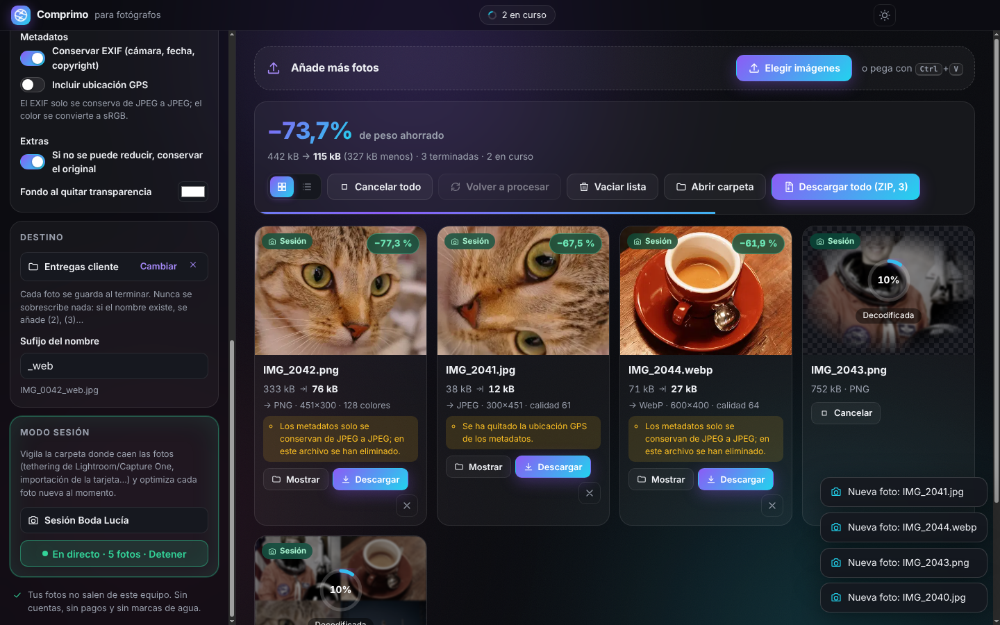

# Comprimo

**Compresor de fotos para fotógrafos. Gratis, sin límites y 100 % local.** App para Mac y versión
web, con códecs profesionales (MozJPEG, libwebp, libavif, libjxl, OxiPNG) que funcionan en tu propio
equipo: tus fotos nunca se suben a ningún sitio. Sin cuentas, sin planes de pago, sin marcas de agua.



## Pensado para una sesión de fotos

- **Modo sesión** (app de escritorio): elige la carpeta donde caen las fotos (tethering de
  Lightroom/Capture One, importación de la tarjeta…) y Comprimo optimiza **cada foto nueva al momento**.
  Espera a que la cámara termine de escribir el archivo antes de leerlo.
- **Guardado automático en carpeta**, con sufijo opcional (`IMG_0042_web.jpg`). Nunca sobrescribe:
  si el nombre ya existe, añade (2), (3)…
- **Preajustes**: Web y portfolio (2560 px, con copyright y sin GPS) · Redes sociales (JPEG 2048 px) ·
  Entrega al cliente (tamaño completo, máxima fidelidad) · Galería de pruebas (1600 px) · Máximo ahorro (AVIF/WebP).
- **Calidad automática por foto**: busca la compresión más fuerte que sigue pareciendo idéntica,
  medida con SSIM multiescala sobre el archivo real.
- **Metadatos bajo control**: conserva el EXIF (cámara, fecha, copyright) de JPEG a JPEG y quita el GPS salvo que lo pidas.
- Comparador antes/después con zoom al 100 %, galería con miniaturas, vista de lista, ZIP de todo,
  detección de duplicados, cancelar/reintentar, notificaciones del sistema y progreso en el Dock.
- Formatos: JPEG, PNG (paleta con transparencia), WebP, AVIF y JPEG XL. Conversión entre ellos.

## Instalar en Mac

1. Descarga el zip de tu Mac desde la página de *Releases* del repositorio (o desde el artefacto de GitHub Actions):
   - Apple Silicon (M1, M2, M3, M4…): `Comprimo-1.0.0-mac-arm64.zip`
   - Intel: `Comprimo-1.0.0-mac-x64.zip`
   - ¿No sabes cuál? Menú  → *Acerca de este Mac*: si pone "Chip Apple", es arm64.
2. Abre el zip y arrastra **Comprimo.app** a *Aplicaciones*.
3. **La primera vez**, macOS dirá que no puede verificar el desarrollador. Es normal: la app tiene
   firma ad-hoc, pero no está firmada con un certificado de Apple Developer ni notarizada (eso cuesta
   99 $/año). Para abrirla:
   - Intenta abrirla una vez y cierra el aviso.
   - Ve a **Ajustes del Sistema → Privacidad y seguridad**, baja hasta el mensaje sobre Comprimo y pulsa **Abrir igualmente**.
   - Alternativa por Terminal: `xattr -dr com.apple.quarantine /Applications/Comprimo.app`
4. Requiere **macOS 13 Ventura o posterior** (lo exige Electron 44).

## Desarrollo

Requisitos: Node.js 22 (o 20.19+) y npm.

```bash
npm install
npm run dev            # versión web con recarga en caliente (http://localhost:5173)
npm run desktop        # app de escritorio (Electron) sobre el build de producción
npm run build && npm run preview   # versión web estática en http://localhost:4173
npm run package:mac    # Comprimo.app (arm64 + x64) en release/
```

`package:mac` funciona en un Mac (firma ad-hoc con `codesign`). Desde Linux también, pasando
`RCODESIGN=/ruta/a/rcodesign` (y `ELECTRON_ZIP_DIR` si la descarga de Electron falla).
El workflow `.github/workflows/mac.yml` lo hace en un Mac de GitHub, verifica la firma con
`codesign --verify --deep --strict`, arranca la app empaquetada y, cuando `package.json` trae una versión nueva, publica los zips como Release `vX.Y.Z`.

## Pruebas

```bash
npm test               # unitarias + integración (códecs WASM reales en Node) → 110
npm run test:e2e       # navegador (Playwright + Chromium) sobre el build → 17
npm run test:electron  # app de escritorio (en Linux sin pantalla: xvfb-run -a npm run test:electron) → 5
npm run bench          # benchmark reproducible → docs/benchmark-data.md
```

## Documentación

- [docs/research.md](docs/research.md): investigación con REA (TinyJPG/TinyPNG), evidencias y límites.
- [docs/feature-matrix.md](docs/feature-matrix.md) · [docs/architecture.md](docs/architecture.md)
- [docs/test-plan.md](docs/test-plan.md) · [docs/test-results.md](docs/test-results.md) · [docs/benchmark-results.md](docs/benchmark-results.md)
- [THIRD_PARTY_LICENSES.md](THIRD_PARTY_LICENSES.md)

## Licencia

MIT. Inspirado en el flujo de TinyJPG/TinyPNG, pero sin relación con Tinify y sin usar su API.
