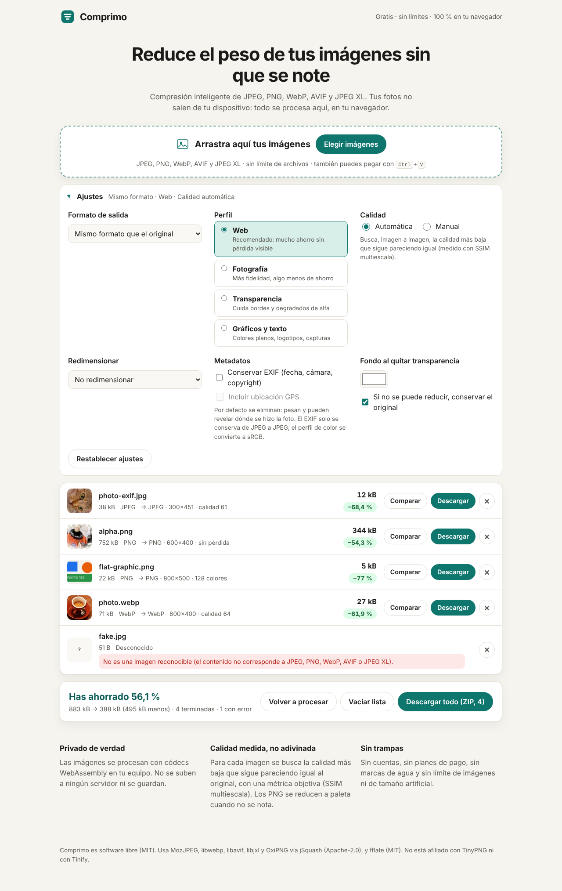

# Comprimo

Compresor y conversor de imágenes **gratis, sin límites y 100 % local**. Funciona en el navegador con
códecs reales compilados a WebAssembly (MozJPEG, libwebp, libavif, libjxl, OxiPNG), así que las imágenes
nunca salen de tu equipo. Sin cuentas, sin claves API, sin planes de pago, sin marcas de agua.

Inspirado en el flujo de trabajo de TinyJPG/TinyPNG (arrastrar, comprimir, descargar), con identidad
propia. **No está afiliado con Tinify** y no usa su API.



## Qué hace

- Arrastrar y soltar, selector múltiple y pegar desde el portapapeles (Ctrl+V). Sin límite de archivos.
- Compresión **automática por imagen**: busca la calidad más baja que sigue pareciendo igual, medida con
  SSIM multiescala sobre el resultado real.
  - JPEG → MozJPEG · PNG → paleta ≤256 colores con alfa + OxiPNG (o sin pérdida si la paleta se nota) ·
    WebP → libwebp (con o sin pérdida) · AVIF → libavif · JPEG XL → libjxl (beta).
- Conversión entre JPEG, PNG, WebP, AVIF y JPEG XL, más un modo **automático** que prueba varios formatos y se queda con el más ligero.
- Perfiles: Web (recomendado), Fotografía, Transparencia, Gráficos y texto. Calidad manual opcional.
- Redimensionado: encajar, escalar por ancho o alto, rellenar (recorte centrado) y porcentaje. Nunca amplía.
- Transparencia conservada; al convertir a JPEG se rellena con un color de fondo configurable (con aviso).
- Metadatos: por defecto se eliminan. Opción de conservar el EXIF de JPEG a JPEG (con la orientación
  normalizada y el GPS quitado salvo que lo pidas).
- Si no se puede reducir, se conserva el original y se avisa; nunca se inventa un porcentaje.
- Comparador antes/después con deslizador (también con teclado) y vista al 100 %.
- Descarga individual y **Descargar todo (ZIP)** con nombres únicos.
- Detección de duplicados (SHA-256), cancelar, reintentar y volver a procesar con otros ajustes.
- Errores concretos: formato no admitido, archivo dañado o truncado, imagen animada, tope técnico de 100 MP.
- Accesible (teclado, `aria-live`, axe sin violaciones graves) y responsive (desde 320 px), con modo oscuro.

## Requisitos

- Node.js 20.19+ o 22.12+ (probado con 22.22) y npm.
- Para usarla: cualquier navegador moderno (Chrome/Edge, Firefox, Safari). La vista previa de AVIF y
  JPEG XL depende del navegador; los archivos generados son válidos en cualquier caso.

## Instalar y ejecutar

```bash
npm install
npm run build      # build de producción en dist/
npm run preview    # sirve dist/ en http://localhost:4173
```

Modo desarrollo con recarga en caliente: `npm run dev` (http://localhost:5173).

`dist/` es un sitio **estático** (≈19 MB contando todos los códecs, que solo se descargan cuando hacen
falta; la página inicial pesa ~85 kB gzip). Se puede servir con cualquier servidor de archivos estáticos.
Ejecutarla en local no cuesta nada; publicarla en Internet depende del hosting que elijas, y no se
promete alojamiento gratuito ni coste cero.

## Pruebas

```bash
npm test             # unitarias + integración (Vitest, códecs WASM reales en Node) → 106 pruebas
npm run test:e2e     # navegador (Playwright + Chromium) sobre el build de producción → 15 pruebas
npm run bench        # benchmark reproducible → docs/benchmark-data.md
npm run fixtures     # regenera tests/fixtures
```

Para `test:e2e` hace falta Chromium para Playwright (`npx playwright install chromium` si no lo tienes).

## Documentación

- [docs/research.md](docs/research.md): investigación con REA, evidencias y límites.
- [docs/feature-matrix.md](docs/feature-matrix.md): funciones del original frente a las de Comprimo.
- [docs/architecture.md](docs/architecture.md): arquitectura y decisiones.
- [docs/test-plan.md](docs/test-plan.md) y [docs/test-results.md](docs/test-results.md): plan y resultados de pruebas.
- [docs/benchmark-results.md](docs/benchmark-results.md): mediciones de compresión.
- [THIRD_PARTY_LICENSES.md](THIRD_PARTY_LICENSES.md): dependencias y licencias.

## Licencia

MIT para el código de Comprimo. Las dependencias mantienen sus licencias (ver `THIRD_PARTY_LICENSES.md`).
